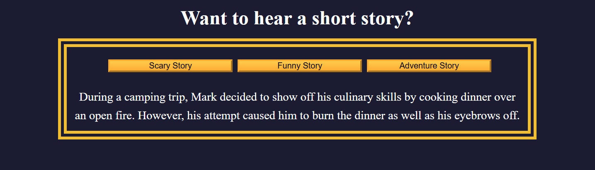

# Storytelling App – Display Interactive Stories with JavaScript and DOM Events

**Live Demo:** [View Live Demo](https://vishwanshv.github.io/freecodecamp-fullstack/javascript-fcc/workshops/storytelling-app/)

## Preview

An interactive storytelling web application that displays scary, funny, and adventure stories when users click the corresponding buttons. Each story has its own border color, dynamically updated using JavaScript.

The application combines HTML, CSS, and JavaScript to create an interactive interface with responsive button layouts and genre-specific styling.

## Technical Highlights

- Structured the application using HTML elements, including headings, buttons, a story container, and a result paragraph.
- Used `document.querySelector()` and `document.getElementById()` to select DOM elements.
- Stored story content and corresponding border colors in a nested JavaScript object.
- Created a `displayStory()` function to display stories based on the selected genre.
- Used `hasOwnProperty()` to check whether a requested story genre exists.
- Updated the paragraph content using `textContent`.
- Dynamically changed the story container's border color using `style.borderColor`.
- Used `addEventListener()` to handle button click events.
- Used arrow functions to connect each button to its corresponding story.
- Applied CSS custom properties using `:root` to manage reusable colors.
- Used Flexbox to arrange buttons vertically on smaller screens and horizontally on wider screens.
- Implemented a media query at `760px` to adjust the button layout responsively.
- Styled buttons with CSS gradients and `:hover` effects.
- Used `box-sizing: border-box` and a universal selector to reset default margins and padding.
- Practiced DOM manipulation, JavaScript objects, functions, event handling, CSS variables, Flexbox, and responsive web design.
